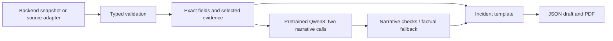

# WUALT incident-report SLM

An installable Python wrapper and REST API for **only the WUALT colour-coded incident report**. The backend supplies a complete incident snapshot. The service validates it, asks a pretrained Qwen3 model for narrative text, checks that text against the evidence, and renders the report as JSON and PDF.

This module is independent of the activity, sleep and snore packages in this repository. It consumes their already-computed observations through the incident payload; it does not run raw audio transcription, speaker identification or wearable signal classification.

## Install

Python 3.11 or newer:

```bash
cd incident_report_slm
python -m venv .venv
# Windows PowerShell: .\.venv\Scripts\Activate.ps1
# Linux/macOS: source .venv/bin/activate
python -m pip install ".[dev]"
python -m pytest -q
```

For backend deployment without test tools, use `python -m pip install .` or `python -m pip install -r requirements.txt`. The wheel includes the UI, four fictional input examples and pinned model metadata. Runtime state is written outside the installed package.

## Pretrained model

The wrapper targets **Qwen/Qwen3-1.7B-GGUF**, quantization **Q8_0**, served by **llama.cpp** under the alias `wualt-qwen3-1.7b`. Model revision, SHA256, expected file size and the Windows runtime release are pinned in [runtime.lock.json](wualt_slm/assets/runtime.lock.json). No fine-tuning is included. The weights download is approximately **1.83 GB**.

On Windows, download and verify the model and pinned Vulkan runtime:

```powershell
wualt-slm setup-model
$server = Get-ChildItem -LiteralPath .runtime/llama -Filter llama-server.exe -Recurse | Select-Object -First 1
& $server.FullName -m models/Qwen3-1.7B-Q8_0.gguf --alias wualt-qwen3-1.7b --host 127.0.0.1 --port 8081 -c 4096 -np 1 -ngl 99 --jinja --reasoning off --no-ui
```

Run that server in its own terminal. Use `-ngl 0` for CPU inference if GPU offload is unavailable; latency depends on hardware. An existing server can be used via `WUALT_MODEL_URL`. For Linux/macOS, `wualt-slm setup-model --model-only` downloads the same verified weights; run a compatible llama.cpp server with the same alias and flags. The download command does not install a Linux/macOS runtime.

If the model server requires authentication, set `WUALT_MODEL_API_KEY` or `WUALT_MODEL_API_KEY_FILE`. Model weights, runtime binaries, credentials and generated user reports are excluded from version control.

Upstream assets: [Qwen model repository](https://huggingface.co/Qwen/Qwen3-1.7B-GGUF), [pinned llama.cpp release](https://github.com/ggml-org/llama.cpp/releases/tag/b11582). Their own licenses apply to those assets.

## Python integration

Create one reusable wrapper per process:

```python
import json
from pathlib import Path
from wualt_slm import IncidentReporter

reporter = IncidentReporter(model_url="http://127.0.0.1:8081")
payload = json.loads(Path("wualt_slm/assets/examples/demo-001.json").read_text())
report = reporter.generate(payload)  # replace payload with your backend's record

print(report["generation_mode"], report["validation_issues"])
Path("incident.pdf").write_bytes(reporter.pdf(report))
```

`generate()` returns an unsaved draft dictionary and accepts either a mapping or an `IncidentBundle`. `pdf(report)` returns PDF bytes. For configured source lookup:

```python
report = reporter.generate_from_source(
    source="server", incident_id="INCIDENT-123", request_id="snapshot-123-v1"
)
```

The wrapper validates IDs and source data. A busy model raises `BackendUnavailable("model_busy")`; missing/unavailable inference or rejected narrative text produces an explicitly marked factual fallback. Reuse the wrapper to share its inference lock. The REST API additionally saves reports and enforces idempotent request IDs.

## REST API and preview

In another terminal, after installing the package:

```bash
wualt-slm serve --data-dir ./outputs
```

Open `http://127.0.0.1:8000/` for the incident preview and `http://127.0.0.1:8000/docs` for the complete OpenAPI contract. The service also accepts `uvicorn wualt_slm.api:app --host 127.0.0.1 --port 8000 --workers 1`.

The main backend integration is:

```python
import httpx

response = httpx.post(
    "http://127.0.0.1:8000/v1/incident-reports",
    json=payload,
    # headers={"X-API-Key": configured_report_api_key},
    timeout=260,
)
response.raise_for_status()
saved = response.json()
pdf = httpx.get(f"http://127.0.0.1:8000/v1/incident-reports/{saved['id']}/pdf")
pdf.raise_for_status()
```

Supply the configured `X-API-Key` on **both** requests when authentication is enabled. Reuse `request_id` only for retries of the same immutable input snapshot; a changed payload with the same ID returns `409`. Busy generation returns `503` with `Retry-After`.

| Endpoint | Purpose |
| --- | --- |
| `GET /health` | API readiness, model reachability and configured source flags |
| `GET /v1/incident-examples` | Four fictional incident IDs |
| `POST /v1/incident-reports` | Generate/save from a complete incident-v1 JSON snapshot |
| `POST /v1/incident-reports/from-source` | Read a configured incident ID, then generate/save |
| `GET /v1/incident-reports` | Recent saved reports |
| `GET /v1/incident-reports/{id}` | Source snapshot, report fields, narratives and provenance |
| `GET /v1/incident-reports/{id}/pdf?download=true` | Download the generated PDF |

## Database and server connection

All source options return the same [incident-v1 payload](wualt_slm/assets/examples/demo-001.json). See [the typed schema](wualt_slm/incident_schema.py) for bounds and validation rules. Required fields include incident/report/request IDs, aware timestamps, the observation window, wearer ID, incident type, audio availability and button status. Unknown fields and inconsistent event timestamps are rejected. Requests are limited to 64 KiB.

For source lookup, send:

```json
{"source":"server","incident_id":"INCIDENT-123","request_id":"snapshot-123-v1"}
```

| Source | Configuration |
| --- | --- |
| `demo` | Four fictional records seeded into the local sample SQLite database |
| `database` | `WUALT_SOURCE_DB`: existing SQLite file, opened read-only |
| `server` | `WUALT_SOURCE_API_BASE`: reads `GET {base}/incidents/{incident_id}`; optional `WUALT_SOURCE_API_TOKEN` bearer header |

The SQLite adapter expects:

```sql
CREATE TABLE incident_source_records (
    incident_id TEXT PRIMARY KEY,
    payload_json TEXT NOT NULL
);
```

`payload_json` and the server response must contain the complete incident-v1 record. Existing PostgreSQL/MySQL schemas can be mapped to this contract by the calling backend and sent directly to the POST endpoint. The model does not receive database credentials or issue SQL. The actual WUALT backend is **not preconfigured** in this package.

Set environment variables before starting the service. `.env.example` documents them; the application does not automatically load a `.env` file. `WUALT_DATA_DIR` controls local report storage, otherwise `~/.wualt-slm/data` is used. `WUALT_API_KEY` enables API-key checks on all `/v1` routes. `WUALT_ALLOWED_ORIGINS` is an exact comma-separated UI origin allowlist; by default only loopback port 8000 is allowed. This is a single-workspace service; a production backend must supply incident ownership and per-user authorization.

## What the model does



The model drafts the **incident description** and **SLM interpretation**. IDs, contacts, measurements, coordinates, GPS-fix age, transcripts, recorded actions and layout come from source data and code. The backend supplies `assessment.context`; the renderer maps it to the illustrative colour band. Missing/unreliable audio forces grey, and an SOS retains urgent priority independently of the colour. The service does not infer a validated risk score, confirm safety, send alerts or fabricate signatures.

Inspect the output metadata:

- `generation_mode="model"`: both model narratives passed checks.
- `generation_mode="mixed"`: one model narrative and one factual replacement.
- `generation_mode="fallback"`: both narratives use factual source-based text.
- `model_sections`, `validation_issues`, `prompt_version`, model revision and evidence IDs record what was used.

The small pretrained model can make semantic errors. The checks catch several known contradictions but do not prove correctness; reports remain drafts for review. In the four-case Desktop validation, two cases retained a model interpretation and two required full fallback. These examples are demonstrations, not a quality benchmark. No training dataset or training job is included.

## CLI, packaging and tests

```bash
wualt-slm generate wualt_slm/assets/examples/demo-001.json --output outputs/report.json --pdf outputs/report.pdf
python -m pytest -q
python -m build
```

Add `--require-model` to fail if the model service is unreachable; accepted generation can still use fallback when model text fails validation. The test suite uses a stub backend, so CI does not download weights or require a GPU. The wheel smoke check exercises installed assets, Python generation, PDF rendering and REST routes from outside the source checkout.

## Optional API container

```bash
docker build -t wualt-incident-slm .
docker run --rm -p 127.0.0.1:8000:8000 --env-file .env -v wualt-reports:/data wualt-incident-slm
```

Copy `.env.example` to `.env` and set `WUALT_MODEL_URL` to a llama.cpp server reachable **from the container**. The model is a separate process; `127.0.0.1:8081` inside the API container does not address the host. Use an appropriate Docker network or host gateway and protect non-loopback model access. This Dockerfile packages the API only; no runtime or model binaries are embedded.
